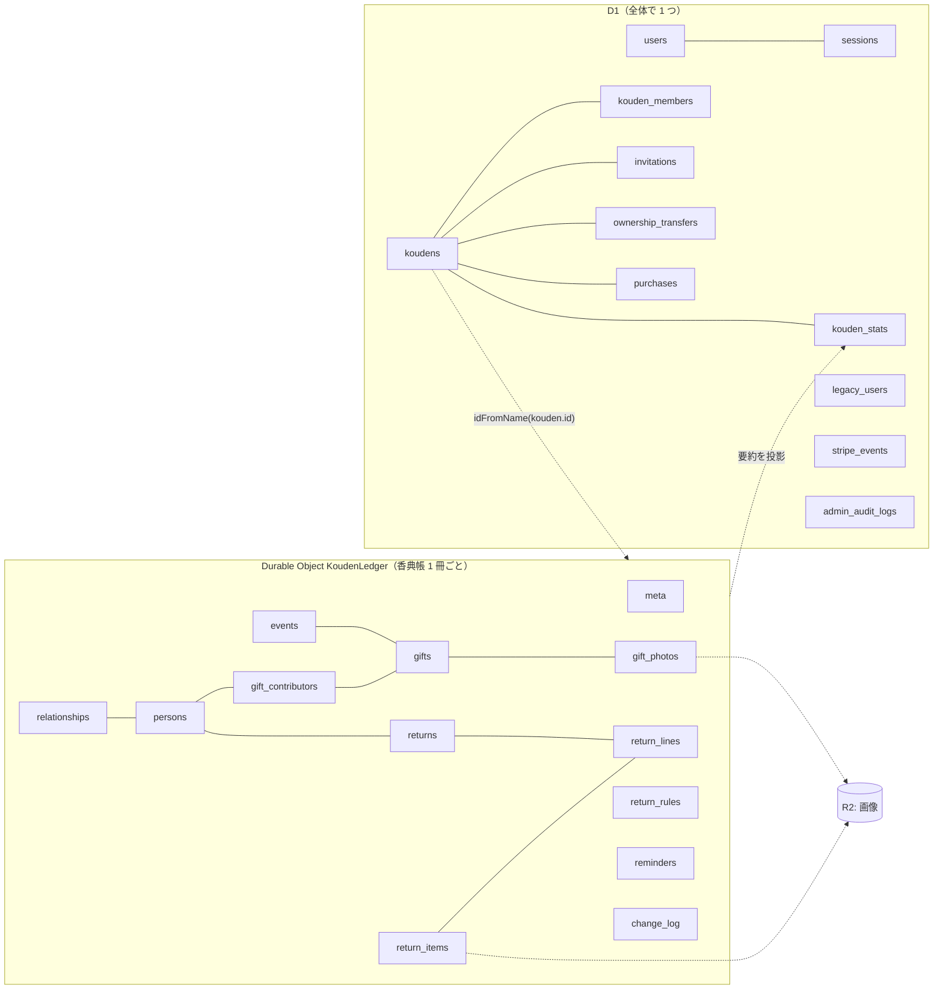

# 03. ドメインモデル

## 1. データの置き場所



| 判断基準 | 置き場所 |
|---|---|
| ログイン前や香典帳を開く前に必要（認証・一覧・権限判定） | D1 |
| 冊をまたいで検索・集計する（運営者画面・統計） | D1 |
| 1 冊の中で完結し、同時編集・採番・履歴の対象になる | DO |

**真実の源（source of truth）は 1 か所だけ**にする。メンバーシップ・オーナー・プラン状態は D1 が正。DO はそれを持たず、Worker が毎リクエストで D1 から読み、DO の呼び出し時に引数で渡す（§5）。`kouden_stats` は DO からの投影で、表示専用（正ではない）。

### 共通規約

| 項目 | 規約 |
|---|---|
| ID | UUIDv7（文字列）。時刻順に並ぶので索引効率が良い |
| 日時 | ISO 8601 UTC 文字列（`2026-10-12T03:04:05.678Z`）。日付のみは `YYYY-MM-DD`（日本時間の暦日） |
| 金額 | 円の整数（INTEGER）。小数を使わない |
| 論理削除 | DO 内の記録は `deleted_at` で論理削除（履歴・取り消しのため）。D1 は必要なテーブルのみ |
| 楽観ロック | 編集対象の行は `version INTEGER`。更新時に期待値と一致しなければ競合 |
| 列挙値 | `TEXT` + `CHECK` 制約。英小文字スネークケース |

---

## 2. D1 スキーマ

```sql
-- ユーザー。Google の sub で一意に識別する
CREATE TABLE users (
  id                TEXT PRIMARY KEY,
  google_sub        TEXT UNIQUE,                -- 移行直後の OTP ユーザーは NULL（初回ログインで埋まる）
  email             TEXT NOT NULL,
  display_name      TEXT NOT NULL,
  avatar_url        TEXT,                       -- Google のプロフィール画像 URL（自前保存しない）
  legacy_user_id    TEXT UNIQUE,                -- 旧 Supabase auth.users.id
  created_at        TEXT NOT NULL,
  updated_at        TEXT NOT NULL,
  deleted_at        TEXT
);
CREATE INDEX idx_users_email ON users(email);

-- セッション。Cookie には生トークン、ここには SHA-256 ハッシュのみ
CREATE TABLE sessions (
  token_hash        TEXT PRIMARY KEY,
  user_id           TEXT NOT NULL REFERENCES users(id) ON DELETE CASCADE,
  created_at        TEXT NOT NULL,
  expires_at        TEXT NOT NULL,              -- 30 日。操作のたびに延長（1 日 1 回まで書き込み）
  last_seen_at      TEXT NOT NULL,
  user_agent        TEXT
);
CREATE INDEX idx_sessions_user ON sessions(user_id);
CREATE INDEX idx_sessions_expires ON sessions(expires_at);

-- 香典帳の目録（中身は DO）
CREATE TABLE koudens (
  id                TEXT PRIMARY KEY,           -- DO 名にも使う
  title             TEXT NOT NULL,
  deceased_name     TEXT NOT NULL,
  deceased_name_confirmed_at TEXT,              -- 移行した故人名の確認日時。旧IDあり・NULLならオーナーへ確認を促す
  owner_user_id     TEXT NOT NULL REFERENCES users(id),
  plan              TEXT NOT NULL DEFAULT 'free' CHECK (plan IN ('free','paid')),
  status            TEXT NOT NULL DEFAULT 'active' CHECK (status IN ('active','archived','deleting')),
  legacy_kouden_id  TEXT UNIQUE,
  created_at        TEXT NOT NULL,
  updated_at        TEXT NOT NULL
);
CREATE INDEX idx_koudens_owner ON koudens(owner_user_id);

-- メンバーシップ（オーナーも 1 行持つ）
CREATE TABLE kouden_members (
  kouden_id         TEXT NOT NULL REFERENCES koudens(id) ON DELETE CASCADE,
  user_id           TEXT NOT NULL REFERENCES users(id) ON DELETE CASCADE,
  role              TEXT NOT NULL CHECK (role IN ('owner','editor','viewer')),
  joined_at         TEXT NOT NULL,
  invited_by        TEXT REFERENCES users(id),
  notify_reminders  INTEGER NOT NULL DEFAULT 0, -- 香典返しの期限のお知らせを受け取るか（編集者が選ぶ。オーナーは常に受け取る）
  PRIMARY KEY (kouden_id, user_id)
);
CREATE INDEX idx_members_user ON kouden_members(user_id);
-- 1 冊にオーナーは 1 人
CREATE UNIQUE INDEX uq_members_one_owner ON kouden_members(kouden_id) WHERE role = 'owner';

-- 招待リンク（URL にはトークン本体、ここにはハッシュ）
CREATE TABLE invitations (
  id                TEXT PRIMARY KEY,
  kouden_id         TEXT NOT NULL REFERENCES koudens(id) ON DELETE CASCADE,
  token_hash        TEXT NOT NULL UNIQUE,
  role              TEXT NOT NULL CHECK (role IN ('editor','viewer')),
  max_uses          INTEGER,                    -- NULL = 無制限
  used_count        INTEGER NOT NULL DEFAULT 0,
  expires_at        TEXT NOT NULL,
  created_by        TEXT NOT NULL REFERENCES users(id),
  created_at        TEXT NOT NULL,
  revoked_at        TEXT
);
CREATE INDEX idx_invitations_kouden ON invitations(kouden_id);

-- オーナー譲渡
CREATE TABLE ownership_transfers (
  id                TEXT PRIMARY KEY,
  kouden_id         TEXT NOT NULL REFERENCES koudens(id) ON DELETE CASCADE,
  from_user_id      TEXT NOT NULL REFERENCES users(id),
  to_user_id        TEXT NOT NULL REFERENCES users(id),
  status            TEXT NOT NULL CHECK (status IN ('pending','accepted','declined','cancelled','expired')),
  created_at        TEXT NOT NULL,
  expires_at        TEXT NOT NULL,              -- 7 日
  resolved_at       TEXT
);
-- 1 冊に保留中の譲渡は 1 件
CREATE UNIQUE INDEX uq_transfers_pending ON ownership_transfers(kouden_id) WHERE status = 'pending';
CREATE INDEX idx_transfers_to ON ownership_transfers(to_user_id) WHERE status = 'pending';

-- 購入。会計の記録なので、香典帳・ユーザーを削除しても残す（外部キーにしない）
CREATE TABLE purchases (
  id                         TEXT PRIMARY KEY,
  kouden_id                  TEXT NOT NULL,
  user_id                    TEXT NOT NULL,
  amount                     INTEGER NOT NULL,
  currency                   TEXT NOT NULL DEFAULT 'jpy',
  stripe_checkout_session_id TEXT UNIQUE,       -- 移行分・手動付与は NULL
  stripe_payment_intent_id   TEXT UNIQUE,       -- 返金（charge.refunded）から購入を探す
  source                     TEXT NOT NULL CHECK (source IN ('stripe','legacy','admin')),
  status                     TEXT NOT NULL CHECK (status IN ('paid','refunded')),
  created_at                 TEXT NOT NULL,
  refunded_at                TEXT
);
CREATE INDEX idx_purchases_kouden ON purchases(kouden_id);

-- Stripe Webhook の冪等化
CREATE TABLE stripe_events (
  event_id          TEXT PRIMARY KEY,
  type              TEXT NOT NULL,
  processed_at      TEXT NOT NULL
);

-- 全額返金された支払い（Stripe のイベントは順不同で届くため、購入の確定より先に届いた返金を覚えておく）
CREATE TABLE stripe_refunds (
  payment_intent_id TEXT PRIMARY KEY,
  refunded_at       TEXT NOT NULL
);

-- 統計用の要約（DO からの投影。表示専用）
CREATE TABLE kouden_stats (
  kouden_id         TEXT PRIMARY KEY REFERENCES koudens(id) ON DELETE CASCADE,
  gift_count        INTEGER NOT NULL,
  total_amount      INTEGER NOT NULL,           -- 香典（kind = 'koden'）の合計
  person_count      INTEGER NOT NULL,
  return_pending    INTEGER NOT NULL,
  last_activity_at  TEXT NOT NULL,
  projected_seq     INTEGER NOT NULL            -- どの change_log.seq 時点の要約か
);

-- 旧ユーザー（自動で紐づかなかった人の手動紐づけ用）
CREATE TABLE legacy_users (
  legacy_user_id    TEXT PRIMARY KEY,
  email             TEXT NOT NULL,
  display_name      TEXT,
  auth_provider     TEXT NOT NULL,              -- 'google' | 'email'
  linked_user_id    TEXT REFERENCES users(id),
  linked_at         TEXT,
  linked_by         TEXT                        -- 'auto' | 運営者メール
);
CREATE INDEX idx_legacy_users_email ON legacy_users(email);

-- 運営者操作の監査ログ
CREATE TABLE admin_audit_logs (
  id                TEXT PRIMARY KEY,
  admin_email       TEXT NOT NULL,              -- Access JWT の email
  action            TEXT NOT NULL,
  target_type       TEXT NOT NULL,
  target_id         TEXT NOT NULL,
  detail            TEXT,                       -- JSON
  created_at        TEXT NOT NULL
);
CREATE INDEX idx_admin_audit_created ON admin_audit_logs(created_at);
```

### D1 の不変条件

| 不変条件 | 担保方法 |
|---|---|
| `koudens.owner_user_id` と `kouden_members` の owner 行が一致する | 譲渡・作成は `db.batch()` で両方を同時に更新する |
| オーナーは 1 冊に 1 人 | 部分ユニーク索引 `uq_members_one_owner` |
| `plan = 'paid'` ⇔ `status = 'paid'` の購入が 1 件以上ある | 購入・返金処理で同じ batch 内で更新する。同じ Checkout Session の購入は `stripe_checkout_session_id` の UNIQUE で 1 件に限る（Webhook と完了画面の両方から確定するため）。plan を paid にする UPDATE は有効な購入があることを条件にし、`stripe_refunds` にある支払いは返金済みとして記録する |
| 招待の使用回数 ≤ 上限 | 1 つの `db.batch()` で、条件（無効化・期限・`used_count < max_uses`・香典帳が active）を満たす場合だけ `INSERT INTO kouden_members ... SELECT ... WHERE ...` で参加させ、続けて「直前の INSERT が 1 行を挿入した場合だけ」（`changes() = 1`）`used_count` を加算する（同じ人の二度押しで加算が重ならない）。D1 の書き込みは直列なので、同時に受けても上限を超えない |
| 譲渡の承諾は 1 回だけ・オーナーは 1 人 | 1 つの `db.batch()` で、譲渡を `accepted` にする（`pending` かつ期限内かつ送り主が現オーナーの場合だけ）→ 旧オーナーを編集者に → 新オーナーをオーナーに → `koudens.owner_user_id` を更新。後続の文は「この承諾で確定した」ことを条件にする |

---

## 3. DO（KoudenLedger）スキーマ

```sql
-- メタ情報（schema_version, kouden_id, created_at など）
CREATE TABLE meta (
  key               TEXT PRIMARY KEY,
  value             TEXT NOT NULL
);

-- 行事（通夜・告別式・四十九日…）。受付番号の採番カウンタを持つ
CREATE TABLE events (
  id                TEXT PRIMARY KEY,
  kind              TEXT NOT NULL CHECK (kind IN ('wake','funeral','memorial_49','memorial_1y','memorial_other','other')),
  name              TEXT NOT NULL,
  date              TEXT,                       -- YYYY-MM-DD
  sort_order        INTEGER NOT NULL,
  next_receipt_no   INTEGER NOT NULL DEFAULT 1,
  version           INTEGER NOT NULL DEFAULT 1,
  created_at        TEXT NOT NULL,
  updated_at        TEXT NOT NULL,
  deleted_at        TEXT
);

-- 故人との関係（ユーザーが追加・変更できる）
CREATE TABLE relationships (
  id                TEXT PRIMARY KEY,
  name              TEXT NOT NULL,
  sort_order        INTEGER NOT NULL,
  is_hidden         INTEGER NOT NULL DEFAULT 0,
  version           INTEGER NOT NULL DEFAULT 1,
  created_at        TEXT NOT NULL,
  updated_at        TEXT NOT NULL
);

-- 差出人
CREATE TABLE persons (
  id                TEXT PRIMARY KEY,
  name              TEXT,                       -- name / organization のどちらかは必須
  name_kana         TEXT,
  organization      TEXT,
  position          TEXT,
  relationship_id   TEXT REFERENCES relationships(id),
  postal_code       TEXT,
  address           TEXT,
  phone             TEXT,
  notes             TEXT,
  search_text       TEXT NOT NULL DEFAULT '',   -- 検索用（氏名・カナ・団体・住所を正規化して連結。ひらがな・カタカナ・全角半角を区別しない）
  version           INTEGER NOT NULL DEFAULT 1,
  created_by        TEXT NOT NULL,
  created_at        TEXT NOT NULL,
  updated_by        TEXT NOT NULL,
  updated_at        TEXT NOT NULL,
  deleted_at        TEXT,
  CHECK (name IS NOT NULL OR organization IS NOT NULL)
);
CREATE INDEX idx_persons_kana ON persons(name_kana);

-- いただきもの（香典・供物・供花・弔電・その他）
CREATE TABLE gifts (
  id                TEXT PRIMARY KEY,
  event_id          TEXT NOT NULL REFERENCES events(id),
  receipt_no        INTEGER,                    -- 移行データは NULL
  kind              TEXT NOT NULL CHECK (kind IN ('koden','kumotsu','kyoka','choden','other')),
  amount            INTEGER,                    -- 香典は必須。供物・供花は任意（金額不明あり）
  item_name         TEXT,                       -- 供物・供花の品名
  quantity          INTEGER,
  message           TEXT,                       -- 弔電の本文
  attendance        TEXT CHECK (attendance IN ('attended','condolence_visit','absent')),
  notes             TEXT,
  version           INTEGER NOT NULL DEFAULT 1,
  created_by        TEXT NOT NULL,
  created_at        TEXT NOT NULL,
  updated_by        TEXT NOT NULL,
  updated_at        TEXT NOT NULL,
  deleted_at        TEXT,
  CHECK (kind <> 'koden' OR amount IS NOT NULL)
);
CREATE UNIQUE INDEX uq_gifts_receipt ON gifts(event_id, receipt_no) WHERE receipt_no IS NOT NULL;
CREATE INDEX idx_gifts_event ON gifts(event_id) WHERE deleted_at IS NULL;

-- いただきもの ↔ 差出人（連名対応。単名でも必ず 1 行）
CREATE TABLE gift_contributors (
  gift_id           TEXT NOT NULL REFERENCES gifts(id),
  person_id         TEXT NOT NULL REFERENCES persons(id),
  is_primary        INTEGER NOT NULL DEFAULT 0,
  share_amount      INTEGER,                    -- 連名時の負担額（任意）。香典返しの計算に使う
  PRIMARY KEY (gift_id, person_id)
);
CREATE INDEX idx_contributors_person ON gift_contributors(person_id);
-- 代表者は 1 件に 1 人
CREATE UNIQUE INDEX uq_contributors_primary ON gift_contributors(gift_id) WHERE is_primary = 1;

-- 供物・供花の写真（本体は R2: koudens/{koudenId}/gifts/{giftId}/{photoId}）
CREATE TABLE gift_photos (
  id                TEXT PRIMARY KEY,
  gift_id           TEXT NOT NULL REFERENCES gifts(id),
  r2_key            TEXT NOT NULL,
  caption           TEXT,
  created_by        TEXT NOT NULL,
  created_at        TEXT NOT NULL,
  updated_at        TEXT NOT NULL,
  deleted_at        TEXT
);

-- 画像の形式・サイズ・SHA-256 は R2 のメタデータを正として照合する。

-- 返礼品カタログ（画像は R2: koudens/{koudenId}/return-items/{id}）
CREATE TABLE return_items (
  id                TEXT PRIMARY KEY,
  name              TEXT NOT NULL,
  category          TEXT,
  price             INTEGER NOT NULL,
  description       TEXT,
  image_r2_key      TEXT,
  is_active         INTEGER NOT NULL DEFAULT 1,
  sort_order        INTEGER NOT NULL,
  version           INTEGER NOT NULL DEFAULT 1,
  created_at        TEXT NOT NULL,
  updated_at        TEXT NOT NULL
);

-- 金額帯ルール（例: 5,000〜9,999 円 → 半返し / 推奨品 X）
CREATE TABLE return_rules (
  id                TEXT PRIMARY KEY,
  min_amount        INTEGER NOT NULL,
  max_amount        INTEGER,                    -- NULL = 上限なし
  ratio_numerator   INTEGER NOT NULL,           -- 1/2 返しなら 1
  ratio_denominator INTEGER NOT NULL,           -- 1/2 返しなら 2
  suggested_item_id TEXT REFERENCES return_items(id),
  sort_order        INTEGER NOT NULL,
  version           INTEGER NOT NULL DEFAULT 1
);

-- 香典返し（差出人 1 人につき 1 件）
CREATE TABLE returns (
  id                TEXT PRIMARY KEY,
  person_id         TEXT NOT NULL UNIQUE REFERENCES persons(id),
  status            TEXT NOT NULL CHECK (status IN ('pending','arranged','shipped','handed_on_day','not_required')),
  method            TEXT CHECK (method IN ('on_day','shipping','hand_delivery')),
  on_day_amount     INTEGER NOT NULL DEFAULT 0, -- 当日返しで渡した額（差し引き計算用）
  due_date          TEXT,
  arranged_at       TEXT,
  shipped_at        TEXT,
  ship_name         TEXT,                       -- 送付先（未入力なら差出人の住所を使う）
  ship_postal_code  TEXT,
  ship_address      TEXT,
  ship_phone        TEXT,
  notes             TEXT,
  version           INTEGER NOT NULL DEFAULT 1,
  created_by        TEXT NOT NULL,
  created_at        TEXT NOT NULL,
  updated_by        TEXT NOT NULL,
  updated_at        TEXT NOT NULL
);
CREATE INDEX idx_returns_status ON returns(status);

-- 香典返しの明細（品名・単価はスナップショット。カタログ変更の影響を受けない）
CREATE TABLE return_lines (
  id                TEXT PRIMARY KEY,
  return_id         TEXT NOT NULL REFERENCES returns(id),
  return_item_id    TEXT REFERENCES return_items(id),
  name              TEXT NOT NULL,
  unit_price        INTEGER NOT NULL,
  quantity          INTEGER NOT NULL DEFAULT 1
);

-- リマインド（DO アラームで発火）
CREATE TABLE reminders (
  id                TEXT PRIMARY KEY,
  kind              TEXT NOT NULL CHECK (kind IN ('return_due_14d','return_due_3d')),
  event_id          TEXT NOT NULL REFERENCES events(id),
  fire_at           TEXT NOT NULL,
  sent_at           TEXT,
  UNIQUE (kind, event_id)
);

-- 変更ログ（追記専用）。履歴表示・リアルタイム通知・投影の連番を兼ねる
CREATE TABLE change_log (
  seq               INTEGER PRIMARY KEY AUTOINCREMENT,
  at                TEXT NOT NULL,
  actor_user_id     TEXT NOT NULL,              -- 'system' はアラーム等
  actor_name        TEXT NOT NULL,              -- 表示名のスナップショット
  entity            TEXT NOT NULL,              -- 'gift' | 'person' | 'return' | 'event' | 'relationship' | 'member' | 'kouden' | ...
  entity_id         TEXT NOT NULL,
  op                TEXT NOT NULL CHECK (op IN ('create','update','delete','restore','merge','import')),
  diff              TEXT                        -- JSON: {"amount":[5000,10000], ...}
);
CREATE INDEX idx_change_log_entity ON change_log(entity, entity_id);
```

### 集計値は保存しない

合計金額・件数・差出人ごとの受取合計は**保存せず、毎回 SQL で計算する**。DO 内の SQLite はプロセス内で動くのでネットワーク往復がなく、1 冊（数百〜数千行）の集計は 1ms 未満で済む。現行の `total_amount` をトリガーで同期する仕組みのような「整合が崩れる余地」をなくす。

### DO の不変条件

すべての書き込みは DO のメソッド内で 1 トランザクション（`ctx.storage.transactionSync`）として実行する。

| 不変条件 | 担保方法 |
|---|---|
| 受付番号は行事内で重複しない | `events.next_receipt_no` の読み出しと加算を同じトランザクションで行う + 部分ユニーク索引 |
| 無料プランでは有効ないただきものが 30 件以下 | 作成・復元時に `plan` 引数と件数を検査 |
| 書き込みごとに変更ログが 1 行以上追加される | 書き込みメソッドの共通ラッパーで強制 |
| 楽観ロック | `UPDATE ... WHERE id = ? AND version = ?` の更新件数が 0 なら `CONFLICT` を返す |
| いただきものには差出人が 1 人以上いる | 作成メソッドで `gift_contributors` を同時に挿入。最後の 1 人は外せない |
| 連名の負担額の合計 ≤ 金額 | 金額・負担額を変える書き込みの中で合計を確認し、超えるなら失敗させる |

---

## 4. DO スキーマの移行

DO は数が多く、一斉にスキーマを変更できない。そこで**各 DO が起動時に自分で追いつく**方式にする。

```ts
// KoudenLedger のコンストラクタ（概略）
constructor(ctx: DurableObjectState, env: Env) {
  super(ctx, env);
  ctx.blockConcurrencyWhile(async () => {
    migrate(ctx.storage.sql, MIGRATIONS); // meta.schema_version を見て未適用分を順に実行
  });
}
```

- マイグレーションはコード内の配列（`MIGRATIONS[n]`）。番号は単調増加で、適用済みのものは変更しない。
- **後方互換な変更のみ**を基本とする（列の追加、テーブルの追加）。破壊的変更は「新列追加 → 両方書く → 旧列を読まなくする → 次々回で削除」の段階を踏む。
- 長期間アクセスされない DO は古いスキーマのまま眠っているが、次に起動したときに追いつくので問題ない。
- 実装では、コンストラクタではなく各 RPC の最初で `migrate` を呼ぶ（`deleteAll()` の後に作り直せるようにするため）。DO 内の RPC は同期的に SQL を実行するので、途中に別の呼び出しが割り込むことはない。
- 1 番（M1）は台帳の骨格（`events` / `relationships` / `persons` / `gifts` / `gift_contributors` / `change_log`）だけを作る。2 番（M3）で香典返し（`return_items` / `return_rules` / `returns` / `return_lines`）とリマインド（`reminders`）を追加した。写真のテーブルは後のマイルストーンで追加する。
- 新しい DO は、最初の呼び出しで `meta.kouden_id` を記録し、既定の行事・関係を作る（変更ログの記録者は `system`）。D1 への登録と DO の初期化の間で失敗しても、次に開いたときに初期化されるので、作成処理で DO を呼ぶ必要はない。

## 5. 権限の判定

Worker が D1 から `role` と `plan` を読み、DO の RPC に**呼び出し元コンテキスト**として渡す。DO は外部から直接呼べない（Worker の binding 経由のみ）ので、このコンテキストを信頼してよい。

```ts
type Caller = { koudenId: string; userId: string; displayName: string; role: 'owner' | 'editor' | 'viewer'; plan: 'free' | 'paid' };
await stub.createGift(caller, input);
```

| 操作 | owner | editor | viewer |
|---|:-:|:-:|:-:|
| 閲覧・印刷・Excel 出力 | ✓ | ✓ | ✓ |
| いただきもの・差出人・香典返しの登録・編集・削除 | ✓ | ✓ | |
| 行事・関係・カタログ・金額帯ルールの編集 | ✓ | ✓ | |
| メンバー招待・ロール変更・除外 | ✓ | | |
| 購入・譲渡・アーカイブ・削除 | ✓ | | |

判定は `packages/domain` の `can(role, action)` に集約し、DO の書き込みの共通ラッパーと画面（ボタンの出し分け）の両方で使う。アーカイブ中の香典帳は、Worker が `role` を `viewer` にして DO に渡す（E2-4）。D1 側の操作（招待・譲渡など）は Worker の同名関数で判定する。

## 6. 主要な処理の流れ

### いただきものの登録（受付）

```
Worker: セッション確認 → D1 で role/plan 取得 → stub.createGift(caller, input)
DO (1 トランザクション):
  1. assertCan(caller, 'gift.write')
  2. plan = 'free' なら件数 < 30 を確認
  3. 差出人: 既存 person_id 指定 or 新規作成
  4. receipt_no = events.next_receipt_no; next_receipt_no += 1
  5. gifts, gift_contributors に挿入
  6. change_log に追記 → seq
  コミット後:
  7. 接続中の WebSocket に {type:'changed', seq, entity:'gift', id} を通知
  8. 要約投影を予約（§7）
Worker: 受付番号入りの完了 HTML を返す
```

### 香典返しの一括提案

1. 差出人ごとの受取合計を香典（`kind = 'koden'`）から計算する。単名なら `amount`。連名なら `share_amount`、未入力なら `amount` を人数で均等割り（端数は代表者 `is_primary` に寄せる）
2. 合計（いただいた額）が当てはまる `return_rules` を探す（帯が重なる場合は下限の高い方。なければ半返し）
3. 目安額 = 合計 × 比率 − 当日返しで渡した額（`on_day_amount`）。推奨品が有効ならそれ、なければ目安額に最も近い有効なカタログ品（同じ差なら安い方）を提案する。目安額が 0 なら品は提案せず、当日返しを渡していれば「当日返し済み」で作る
4. 画面で確認・修正 → 確定時に `returns` / `return_lines` を一括作成（1 トランザクション）

### オーナー譲渡（D1 のみ）

承諾時に 1 つの `db.batch()` で以下を実行する。`ownership_transfers` → `accepted`、旧オーナーの member 行 → `editor`、新オーナーの member 行 → `owner`、`koudens.owner_user_id` 更新。DO には変更ログの記録だけを依頼する。

## 7. 統計の投影（DO → D1）

- DO は書き込み後、5 秒後に発火するアラームを予約する（既に予約済みなら何もしない）。
- アラームで現在の要約を計算し、D1 の `kouden_stats` に `INSERT ... ON CONFLICT DO UPDATE ... WHERE excluded.projected_seq >= kouden_stats.projected_seq` で書き込む（古い要約で上書きしない。同じ seq は中身も同じなので上書きしてよく、スキーマの移行で増えた項目を埋めるのに使う）。
- 失敗した場合はアラームの自動再試行に任せる。投影は表示専用なので、遅延しても業務に影響しない。

DO のアラームは 1 オブジェクトにつき 1 つしか持てないため、リマインドと投影は「次に発火すべき最も早い時刻」を計算して 1 つのアラームにまとめ、発火時に期限の来た処理を全部実行する。投影は `kouden_stats.return_pending` に未対応の香典返しの数も書く。

## 8. 削除

| 対象 | 処理 |
|---|---|
| 香典帳の削除 | D1 `koudens.status = 'deleting'` → DO `deleteAll()` + アラーム削除（削除済みの印 `meta.deleted_at` だけを残し、削除の直前に権限確認を通った要求が遅れて届いても台帳を作り直さない）→ R2 の `koudens/{id}/` 以下を削除 → D1 の関連行を削除。途中で失敗しても、日次 Cron が `deleting` のものを再処理する |
| アカウントの削除 | オーナーである冊がすべて譲渡済みまたは削除済みであることを確認 → 1 つの batch で、`users.deleted_at` を設定し、メール・名前を匿名化し、`google_sub` を NULL にする（オーナーの冊が残っていれば何もしない）→ メンバー行・セッション削除・承諾待ちの譲渡の取り消し（匿名化が成功した場合だけ）→ 参加していた冊の DO に知らせて接続を切る（同じ Google アカウントで再登録すると新しい空のアカウントになる。ログイン処理も、削除済みの行が `google_sub` を持っていれば手放させてから登録する）。変更ログの `actor_name` はスナップショットなので残る |
