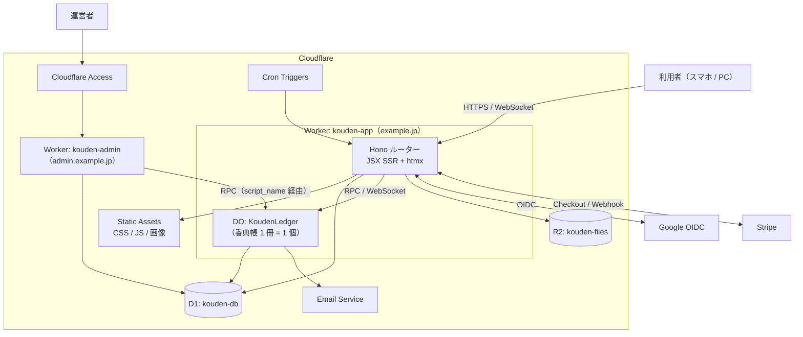

# 04. アーキテクチャ

## 1. 全体構成



| リソース | 名前（本番） | 用途 |
|---|---|---|
| Worker | `kouden-app` | 利用者向け画面・API・Webhook・DO の定義元 |
| Worker | `kouden-admin` | 運営者画面（Access の背後） |
| Durable Object | `KoudenLedger`（SQLite backend） | 香典帳 1 冊の中身 |
| D1 | `kouden-db` | 横断データ（[03 §2](./03-domain-model.md#2-d1-スキーマ)） |
| R2 | `kouden-files` | 返礼品画像・供物写真（非公開。Worker 経由で権限確認して配信）。キーは `koudens/{koudenId}/return-items/{objectId}` で、画像を差し替えるたびに新しい ID にする。配信は `GET /k/:id/files/return-items/:objectId`（メンバーのみ。URL の香典帳 ID でキーを組み立てるので、他の香典帳の画像は読めない）で、`Cache-Control: private, max-age=31536000, immutable`。アップロードは JPEG・PNG・WebP の 5 MB まで。形式はブラウザの申告ではなく先頭のバイト列で判定する |
| Static Assets | `kouden-app` に同梱 | Tailwind のビルド成果物、htmx、自前の小さなスクリプト |
| Email Service | `send_email` binding | リマインドメール（`noreply@example.jp`） |
| Rate Limiting | `AUTH_RATE_LIMITER` / `WRITE_RATE_LIMITER` ほか | ログイン・書き込み・招待受諾の回数制限 |
| Cron Triggers | 毎日 03:00 JST | 期限切れセッション・招待の削除、`deleting` の香典帳の再処理、統計の整合確認 |

**ドメイン**: `example.jp`（本番）、`admin.example.jp`（運営者）、`staging.example.jp`（ステージング、Access で保護）。

## 2. リポジトリ構成

Bun workspaces によるモノレポ。

```
v2/                              # 切り替えまでの間、旧実装と同居させる（ADR-T13）
├── apps/
│   ├── app/                     # kouden-app Worker
│   │   ├── cloudflare.config.ts # Worker の設定（mode ごと）
│   │   ├── deploy.settings.ts   # mode ごとの Worker 名・ドメイン・D1 名など
│   │   ├── vite.config.ts
│   │   ├── vitest.config.ts     # テスト用 binding（cloudflare.config.ts と一致を検査）
│   │   ├── migrations/          # D1 マイグレーション
│   │   ├── scripts/             # D1 マイグレーション適用（ローカル / リモート）
│   │   ├── public/              # Static Assets（Tailwind の出力先を含む）
│   │   ├── src/
│   │   │   ├── index.ts         # エントリ（fetch / scheduled）、DO の export
│   │   │   ├── app.tsx          # Hono アプリの組み立て
│   │   │   ├── routes/          # 画面・API（機能ごと）
│   │   │   ├── views/           # JSX（レイアウト・ページ・部分テンプレート）
│   │   │   ├── middleware/      # request-context, session, security（CSRF・CSP）
│   │   │   ├── auth/            # Google OIDC・セッション・ユーザー解決
│   │   │   ├── ledger/          # KoudenLedger（DO）とその SQL・マイグレーション（M1〜）
│   │   │   └── billing/         # Stripe（M4〜）
│   │   └── test/
│   └── admin/                   # kouden-admin Worker（M5〜）
├── packages/
│   ├── domain/                  # 純粋な TS: ID 生成、料金、金額計算、香典返し提案、バリデーション
│   └── ui/                      # 共通 JSX コンポーネント（admin を作る M5 で切り出す）
└── tools/
    └── migrate-from-supabase/   # 移行ツール（M6、05 参照）
```

**方針**: 業務ルール（金額計算・提案ロジック・入力検証）は `packages/domain` に純粋関数として置き、DO・画面・移行ツールから共有する。DO は「永続化と直列化」、Worker は「認証・認可・描画」に専念する。

## 3. リクエストの流れ

```
GET /k/:koudenId/gifts
  1. session middleware   : Cookie → D1 sessions ⨝ users → c.var.user（なければ /login へ）
  2. kouden-access        : D1 kouden_members ⨝ koudens → c.var.caller {role, plan}（非メンバーは 404）
  3. handler              : stub = env.LEDGER.get(env.LEDGER.idFromName(koudenId))
                            data = await stub.listGifts(caller, query)   ← DO の RPC メソッド
  4. view                 : c.html(<GiftsPage data={data} />)
                            htmx からの要求（HX-Request ヘッダー）なら部分テンプレートだけ返す
```

- DO は **RPC（JS のメソッド呼び出し）** で呼ぶ。`fetch` は WebSocket のアップグレードにだけ使う。
- DO の作成時は `locationHint: 'apac'` を指定し、日本から近い拠点に配置する。
- 1 リクエストで D1 を 2 回（セッション・メンバーシップ）読む。`kouden-access` は 1 クエリに結合する。

## 4. 認証

### Google OIDC（利用者）

```
/login → /auth/google/start
  state, nonce, PKCE code_verifier を生成し、署名付きの短命 Cookie（10 分）に保存
  → accounts.google.com（scope: openid email profile）
/auth/google/callback
  1. state 照合、code + code_verifier でトークン交換
  2. ID トークンを Google の JWKS で検証（iss, aud, exp, nonce）
  3. ユーザー解決:
     a. users.google_sub が一致 → そのユーザー
     b. なければ、メールが Gmail または Google Workspace（hd がメールのドメインと一致）で、
        確認済み・未紐づけの旧ユーザーと 1 件だけ一致すれば、google_sub を設定して紐づけ（linked_by = 'auto'）
        それ以外のアドレスは自動では紐づけない（ADR-P17。運営者が手動で紐づける）
     c. どちらもなければ新規作成
  4. セッション発行: 32 バイトの乱数 → Cookie `__Host-kouden_session`（HttpOnly, Secure, SameSite=Lax, Path=/, 30 日）
                     D1 には SHA-256 ハッシュのみ保存
  5. 元の URL（招待リンクなど）へリダイレクト
```

- OAuth ライブラリは使わず、認可 URL の組み立てとトークン交換は自前で実装した（数十行）。ID トークンは `jose` で Google の JWKS を使って検証する（`iss`, `aud`, `exp`, `nonce`）。state・nonce・PKCE の値は、署名付きの短命 Cookie `__Host-kouden_oauth` に入れる。
- Google の `sub` はアカウント固有で、OAuth クライアントが変わっても同じ値になる。旧 Supabase の Google ユーザーは `auth.identities.provider_id` に `sub` が入っているので、移行時に `users.google_sub` を事前に埋めておける（[05](./05-migration-plan.md)）。

### CSRF 対策

- Cookie は `SameSite=Lax`。
- GET 以外の要求は `Origin` ヘッダーが自ドメインと一致することを必須にする（Hono の `csrf` ミドルウェア）。
- htmx の要求も通常のフォーム送信と同じ扱い。トークンの埋め込みは不要。

### 既知の制約（受け入れ済み）

- ログイン開始（`/auth/google/start`）は GET で一時 Cookie を上書きするため、ログイン途中に外部ページから遷移させられると、進行中のログインが state 不一致で失敗する。表示は「ログインに失敗しました」で、再試行すれば成功する。攻撃者のアカウントでログインさせる攻撃（login CSRF）は state と nonce の照合で防げているため、影響は再試行 1 回にとどまる。Cookie を state ごとに分ける対策は効果に比べてコードが増えるので、採用しない（otomatty/kouden#161 のレビューで判断）。

### Cloudflare Access（運営者）

- `admin.example.jp` 全体を Access アプリケーションにし、ポリシーで運営者のメールアドレスだけを許可する。
- `kouden-admin` は `Cf-Access-Jwt-Assertion` を Access の公開鍵で検証し（`aud` = アプリケーションの AUD タグ）、`email` を監査ログに記録する。
- `kouden-admin` は `kouden-app` の DO を `script_name` 指定の binding で参照する。**香典帳の中身（個人情報）を読む RPC は運営者画面に公開しない**。

## 5. リアルタイム同期と編集中表示

### 接続

```
ブラウザ（香典帳の画面を開くと）
  new WebSocket('wss://example.jp/k/:koudenId/ws')
Worker
  session + kouden-access を通過し、Origin が自分のオリジンと一致したら（他サイトからの接続を拒否）、
  caller 情報（JSON を URL エンコード）をヘッダー X-Kouden-Caller に付けて DO の fetch へ転送
DO
  ctx.acceptWebSocket(ws, [userId])           ← Hibernation API（待機中は課金されない）
  ws.serializeAttachment({ userId, name, editing: null, pending: true })
  D1 でメンバーかを確かめる（Worker の確認後、DO に届く前に除外された場合に備える。先に受け付けるので、
  除外の切断が確認より後でもこの接続は対象に入る）。メンバーでなければ revoked で閉じる
  確認できたら pending を外し、{type: 'hello', seq}（現在の変更ログの位置）を送る（pending の間は通知も閲覧中の表示もしない）
  ping / pong は setWebSocketAutoResponse で DO を起こさずに応答する（ブラウザが 30 秒ごとに送る）
```

### サーバー → ブラウザのメッセージ（JSON）

| type | 内容 | ブラウザの動作 |
|---|---|---|
| `hello` | `{seq}` | 手元の seq より新しければ、その間の変更を `/k/:id/changes?since=` で取り直す。画面には表示した時点の seq（データを読む前に記録）を埋め込んでいるので、表示から最初の接続までの間の変更も取り直せる。取り直しに失敗しても起点を保持し、再試行する。取りこぼしが多すぎる（`reset`）ときは画面全体を読み込み直す |
| `changed` | `{seq, entity, id, op, actor}` | 該当する部分 HTML を取り直す（自分の変更は無視） |
| `presence` | `[{userId, name, editing: {entity, id} \| null}]` | 閲覧中のメンバーと「○○さんが編集中」を表示 |
| `revoked` | — | 権限が外された。接続を閉じて一覧へ戻す |

### 権限の変更と接続の失効

WebSocket は接続時にだけ権限を確認するため、メンバーシップが変わったら DO 側で既存の接続に反映する。

| 操作（D1 の更新が成功した後） | Worker → DO | DO の処理 |
|---|---|---|
| メンバーの除外・本人の退出 | `stub.recordExternalChange(actor, {entity: 'member', op: 'delete'}, {revokeUserId})` | 変更ログに記録し、`ctx.getWebSockets(userId)` の接続に `revoked` を送って閉じる |
| 参加・ロールの変更・オーナー譲渡 | `stub.recordExternalChange(actor, {entity: 'member', ...})` | 変更ログに記録し、`changed`（entity: `member`）を送る。本人の画面は読み込み直して新しいロールの表示になる |
| アーカイブ・解除 | `stub.recordExternalChange(actor, {entity: 'kouden', ...})` | 全員のロールの実効値が変わるので、全員の画面が読み込み直す。アーカイブ中はメンバーの変更（ロール変更・除外・招待・譲渡の申し出）もできない（退出と、保留中の譲渡への応答・取り消しはできる） |
| 香典帳の削除 | `stub.deleteAll()` | 中身を消す前に全接続に `revoked` を送って閉じる |

D1 の更新と DO への通知の間で失敗しても、権限の正は D1 にあり、各端末が取り直す HTTP 要求はその都度 D1 で権限確認されるため、閲覧できるのは通知（`changed` の種類と ID）までに限られる。DO への通知が失敗した場合は Worker が再試行する。

**HTML ではなく通知だけを送る**のがポイント。部分 HTML は各端末が通常の GET で取り直すので、ロールによる表示の違い（編集ボタンの有無など）を DO 側で考える必要がない。

### ブラウザ側

htmx 本体と、WebSocket を扱う小さな自前スクリプト（`public/assets/ledger-live.js`、数 KB）だけを使う。画面側は HTML の属性で指示する。

```html
<!-- 取り直す部分: gift / person が変わったら data-live-url を取り直して差し替える -->
<div id="overview" data-live="gift,person,event,relationship" data-live-url="/k/abc?partial=overview">
  <p data-stale-notice hidden>他の人の変更があります。<a href="">再読み込み</a></p>
  …
</div>
<!-- 編集フォーム: 開いている間は「編集中」を知らせる -->
<form data-editing-entity="gift" data-editing-id="…">…</form>
<!-- 「○○さんが編集中」の表示先 -->
<span data-editing-target="gift:…"></span>
<!-- 開いている記録が他の人に更新されたら表示する -->
<p data-live-watch="gift:…" hidden>この記録は他の人が更新しました。</p>
```

- **取り直し**: `changed` を受けると、`data-live` に該当する部分の `data-live-url` を `htmx.ajax` で取り直す（300ms でまとめる）。ただし、その部分の中で入力中（編集フォームが開いている・入力欄にフォーカスがある）なら差し替えず、`data-stale-notice` を表示する。`data-live-url` のない部分（設定・メンバー）も同様にお知らせだけを出す。
- **再接続**: 指数バックオフで自動再接続。再接続時に `/k/:id/changes?since=lastSeq` で取りこぼした変更の種類を取得し、該当部分を取り直す。
- **編集中表示**: 編集フォームを開いたら `{"type":"editing","entity":"gift","id":"…"}` を送り、閉じたら `null` を送る。DO は attachment を更新して `presence` を全員に配信する。
- **競合**: 編集フォームは開いた時点の `version` を hidden で持つ。保存時に DO が `CONFLICT` を返したら、差分表示と「上書きする / 破棄する」の選択肢を出す。

### オフライン警告

`navigator.onLine` と WebSocket の接続状態のどちらかが切れたら、画面上部に警告バナーを出し、`[data-requires-online]` の送信ボタンを無効にする。

## 6. 画面技術

| 項目 | 方針 |
|---|---|
| テンプレート | Hono JSX（`hono/jsx`）。ページ = レイアウト + 部分テンプレート。部分テンプレートは htmx からも直接返す |
| 部分更新 | htmx 2.x（`hx-get` / `hx-post` / `hx-swap` / `hx-trigger`）。設定は `<meta name="htmx-config">` で `selfRequestsOnly: true`・`allowEval: false`・`includeIndicatorStyles: false`（CSP のため）、入力エラー（422）と競合（409）の応答も差し替える。本体は npm で版を固定し、ビルド時に Static Assets へコピーする（CDN は使わない） |
| 段階的な拡張 | すべてのフォームは htmx なしでも通常の POST → リダイレクトで動く。htmx は受付の連続入力・差出人の候補表示・一覧の行内編集にだけ使う |
| スタイル | Tailwind CSS。CLI でビルドして Static Assets に出力。共通部品（ボタン・フォーム・ダイアログ・テーブル）は `packages/ui` に JSX コンポーネントとして作る |
| ダイアログ | ネイティブの `<dialog>` 要素を使う |
| 入力検証 | サーバー側で Zod（`packages/domain`）。エラー時はフォームの部分テンプレートをエラー付きで返す。クライアント側は HTML 標準属性（`required`, `inputmode`, `pattern`）のみ |
| CSP | `script-src 'self' 'nonce-…'`。インラインのイベントハンドラ（`hx-on`）は使わない |
| JS 予算 | 1 ページあたり htmx + 自前スクリプトで gzip 後 25KB 以内 |

### 画面構成（主要なもの）

| パス | 画面 | 主な端末 |
|---|---|---|
| `/` | LP（未ログイン）/ 香典帳一覧（ログイン済み） | 両方 |
| `/k/:id` | 香典帳トップ（合計・行事別サマリー・最近の登録） | 両方 |
| `/k/:id/reception?event=…` | 受付入力（大きな受付番号、連続入力） | スマホ |
| `/k/:id/gifts` | いただきもの一覧（絞り込み・連続編集） | PC |
| `/k/:id/persons/:pid` | 差出人の詳細（いただきもの・香典返し・履歴） | 両方 |
| `/k/:id/returns` | 香典返し（一括提案・状況の一覧と絞り込み） | PC |
| `/k/:id/returns/:rid` | 香典返し 1 件（状況・送付先・品・変更履歴） | 両方 |
| `/k/:id/returns/settings` | 返礼品カタログ（画像）・金額帯ルール | PC |
| `/k/:id/print/*` | 印刷用ページ | PC |
| `/k/:id/members` | メンバー・ロール・招待リンク（QR コード）・オーナー譲渡・退出 | 両方 |
| `/k/:id/settings` | 香典帳の情報・行事・関係・購入・アーカイブ・削除 | 両方 |
| `/invite/:token` | 招待の受諾（ログイン前は香典帳名とログインボタン、ログイン後は「参加する」ボタン。GET では参加しない） | スマホ |

## 7. 決済（Stripe）

```
オーナーが「購入」→ POST /k/:id/billing/checkout
  Checkout Session（mode=payment, ¥2,980, metadata: {kouden_id, user_id}）を作成してリダイレクト
POST /webhooks/stripe
  1. 署名検証（stripe SDK の constructEventAsync。Workers の Web Crypto で動作）
  2. イベントの記録と D1 の更新を、1 つの db.batch() で原子的に確定する
     checkout.session.completed かつ payment_status=paid:
       db.batch([ stripe_events INSERT, purchases INSERT, koudens.plan = 'paid' ])
     charge.refunded:
       db.batch([ stripe_events INSERT, purchases.status = 'refunded',
                  有効な購入がなければ koudens.plan = 'free' ])
  3. stripe_events の主キー重複でバッチが失敗した場合は処理済みとみなして 200 を返す
     それ以外の失敗は 500 を返す（バッチ全体がロールバックされるので、Stripe の再送で再処理される）
```

`plan` は D1 が正で、DO は毎回の呼び出しで受け取るため、DO への通知は不要。返金で `free` に戻っても既存の記録は消さず、新規登録だけが止まる。

## 8. 帳票出力

| 出力 | 実装 |
|---|---|
| 印刷用ページ | `/k/:id/print/*` で A4 用の HTML を返す。`@page { size: A4 }`、改ページ制御、ヘッダー・フッター。ブラウザの「印刷 / PDF に保存」を使う |
| Excel | Worker で `.xlsx` を生成して返す。**ライブラリは M4 の前に PoC で選定する**（Workers で動くこと、バンドルサイズ、日本語・書式の扱い）。Workers で困難な場合は、ブラウザ側で生成する案に切り替える |

## 9. メール

```ts
interface Mailer { send(msg: { to: string; subject: string; text: string; html?: string }): Promise<void> }
class CloudflareMailer implements Mailer { /* env.EMAIL.send(...) */ }
// 問題があれば ResendMailer に差し替える
```

- 送信元: `noreply@example.jp`。SPF・DKIM・DMARC は Email Service のドメイン登録で設定される。
- 送信するのは香典返しのリマインドのみ。DO のアラームから送る。
- 宛先はオーナーと、通知を希望した編集者（D1 `kouden_members.notify_reminders`。編集者がメンバーの画面で自分で切り替える）。
- 期限は四十九日の行事の日付。その 14 日前と 3 日前の 9:00（日本時間）に、未対応の件数（いただいた額（連名は按分）が 0 円より多い差出人のうち、香典返しがないか「未対応」の人数。一括提案の対象と同じ条件）を知らせる。未対応が 0 件のとき・アーカイブ中は送らない。行事の日付を変えると予定を作り直し、すでに過ぎた分は送らない。
- 全員への送信に失敗したら、送信済みにせず 30 分後にアラームを予約し直して送り直す（アラームの自動再試行は数分で終わり、使い切ると予約が消えるため、例外にはしない）。一部だけ失敗した場合は送信済みとして記録し、ログに残す（二重送信を避ける）。

## 10. 環境と CI/CD

| 環境 | Worker 名 | D1 / R2 | 公開範囲 |
|---|---|---|---|
| ローカル（`development`） | `bun run dev`（`cf dev` + Tailwind の監視） | `.cloudflare/state` の模擬環境 | 開発者のみ |
| ステージング | `kouden-app-staging` / `kouden-admin-staging` | `kouden-db-staging` / `kouden-files-staging` | `staging.example.jp`。Access で開発者のみ |
| 本番 | `kouden-app` / `kouden-admin` | `kouden-db` / `kouden-files` | `example.jp` |

環境は `cf` の mode で切り替える（`--mode staging` など）。Worker 名・ドメイン・D1 名は `deploy.settings.ts` に集約している。DO の名前空間は Worker ごとに独立するため、Worker 名を分ければ環境ごとに自動で分離される。

**GitHub Actions**
1. `v2-ci.yml`（PR と `main` への push、`v2/` 配下の変更時）: `oxfmt --check` → `oxlint` → 型チェック → `vitest`（`@cloudflare/vitest-plugin` で D1・DO を含めて Workers ランタイム上で実行）→ `cf build`
2. `v2-deploy.yml`（手動実行。`staging` / `production` を選ぶ）: テスト → D1 マイグレーション → `cf deploy --secrets-file` → （初回のみ）D1 マイグレーション。GitHub の Environments でシークレットと承認ルールを管理する
3. ステージングへのデプロイ後の Playwright による E2E は M1 以降で追加する

## 11. 運用

| 項目 | 方針 |
|---|---|
| ログ | Workers Logs を有効化。1 行 1 JSON で `requestId`, `userId`, `koudenId`, `route`, `status`, `ms` を出す。**差出人の個人情報はログに出さない**。招待リンクのトークンはパスから伏せる（`/invite/:token`） |
| アラート | Cloudflare の通知機能で、エラー率・CPU 超過を通知 |
| バックアップ | D1 Time Travel（30 日）、DO SQLite の Point-in-Time Recovery（30 日）。加えて週次で全香典帳のエクスポートを R2 の別バケット（ライフサイクル 90 日）に保存する |
| 回数制限 | ログイン開始: IP ごと 20 回/分。書き込み: ユーザーごと 120 回/分。招待受諾: IP ごと 10 回/分 |
| シークレット | `GOOGLE_CLIENT_SECRET`, `SESSION_SECRET`（M4 で `STRIPE_SECRET_KEY`, `STRIPE_WEBHOOK_SECRET` を追加）。GitHub の Environments に保存し、デプロイ時に `cf deploy --secrets-file` で渡す。ローカルは `.dev.vars` |
