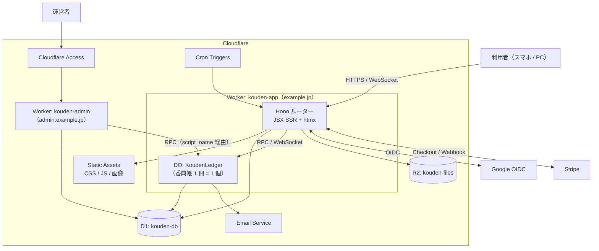

# 04. アーキテクチャ

## 1. 全体構成



| リソース | 名前（本番） | 用途 |
|---|---|---|
| Worker | `kouden-app` | 利用者向け画面・API・Webhook・DO の定義元 |
| Worker | `kouden-admin` | 運営者画面（Access の背後） |
| Durable Object | `KoudenLedger`（SQLite backend） | 香典帳 1 冊の中身 |
| D1 | `kouden-db` | 横断データ（[03 §2](./03-domain-model.md#2-d1-スキーマ)） |
| R2 | `kouden-files` | 返礼品画像・供物写真（非公開。Worker 経由で権限確認して配信） |
| Static Assets | `kouden-app` に同梱 | Tailwind のビルド成果物、htmx、自前の小さなスクリプト |
| Email Service | `send_email` binding | リマインドメール（`noreply@example.jp`） |
| Rate Limiting | `ratelimit` binding | ログイン・書き込み・招待受諾の回数制限 |
| Cron Triggers | 毎日 03:00 JST | 期限切れセッション・招待の削除、`deleting` の香典帳の再処理、統計の整合確認 |

**ドメイン**: `example.jp`（本番）、`admin.example.jp`（運営者）、`staging.example.jp`（ステージング、Access で保護）。

## 2. リポジトリ構成

Bun workspaces によるモノレポ。

```
.
├── apps/
│   ├── app/                    # kouden-app Worker
│   │   ├── src/
│   │   │   ├── index.ts        # Hono エントリ、DO の export
│   │   │   ├── routes/         # 画面・API（機能ごと）
│   │   │   ├── views/          # JSX（ページ・部分テンプレート）
│   │   │   ├── middleware/     # session, kouden-access, csrf, rate-limit
│   │   │   ├── ledger/         # KoudenLedger（DO）とその SQL・マイグレーション
│   │   │   ├── auth/           # Google OIDC
│   │   │   └── billing/        # Stripe
│   │   ├── public/             # Static Assets
│   │   ├── migrations/         # D1 マイグレーション（wrangler d1 migrations）
│   │   └── wrangler.jsonc
│   └── admin/                  # kouden-admin Worker
├── packages/
│   ├── domain/                 # 純粋な TS: 金額計算、香典返し提案、バリデーション（Zod）
│   └── ui/                     # 共通 JSX コンポーネント、Tailwind 設定
├── tools/
│   └── migrate-from-supabase/  # 移行ツール（05 参照）
└── docs/rebuild/
```

**方針**: 業務ルール（金額計算・提案ロジック・入力検証）は `packages/domain` に純粋関数として置き、DO・画面・移行ツールから共有する。DO は「永続化と直列化」、Worker は「認証・認可・描画」に専念する。

## 3. リクエストの流れ

```
GET /k/:koudenId/gifts
  1. session middleware   : Cookie → D1 sessions ⨝ users → c.var.user（なければ /login へ）
  2. kouden-access        : D1 kouden_members ⨝ koudens → c.var.caller {role, plan}（非メンバーは 404）
  3. handler              : stub = env.LEDGER.get(env.LEDGER.idFromName(koudenId))
                            data = await stub.listGifts(caller, query)   ← DO の RPC メソッド
  4. view                 : c.html(<GiftsPage data={data} />)
                            htmx からの要求（HX-Request ヘッダー）なら部分テンプレートだけ返す
```

- DO は **RPC（JS のメソッド呼び出し）** で呼ぶ。`fetch` は WebSocket のアップグレードにだけ使う。
- DO の作成時は `locationHint: 'apac'` を指定し、日本から近い拠点に配置する。
- 1 リクエストで D1 を 2 回（セッション・メンバーシップ）読む。`kouden-access` は 1 クエリに結合する。

## 4. 認証

### Google OIDC（利用者）

```
/login → /auth/google/start
  state, nonce, PKCE code_verifier を生成し、署名付きの短命 Cookie（10 分）に保存
  → accounts.google.com（scope: openid email profile）
/auth/google/callback
  1. state 照合、code + code_verifier でトークン交換
  2. ID トークンを Google の JWKS で検証（iss, aud, exp, nonce）
  3. ユーザー解決:
     a. users.google_sub が一致 → そのユーザー
     b. なければ email_verified = true かつ legacy_users.email が一致し未紐づけ
        → 旧ユーザーのレコードに google_sub を設定して紐づけ（linked_by = 'auto'）
     c. どちらもなければ新規作成
  4. セッション発行: 32 バイトの乱数 → Cookie `__Host-kouden_session`（HttpOnly, Secure, SameSite=Lax, Path=/）
                     D1 には SHA-256 ハッシュのみ保存
  5. 元の URL（招待リンクなど）へリダイレクト
```

- ライブラリは実装時に選定する（候補: `arctic`、`@hono/oauth-providers`）。ID トークンの検証は `jose` 相当の処理で自前でも行う。
- Google の `sub` はアカウント固有で、OAuth クライアントが変わっても同じ値になる。旧 Supabase の Google ユーザーは `auth.identities.provider_id` に `sub` が入っているので、移行時に `users.google_sub` を事前に埋めておける（[05](./05-migration-plan.md)）。

### CSRF 対策

- Cookie は `SameSite=Lax`。
- GET 以外の要求は `Origin` ヘッダーが自ドメインと一致することを必須にする（Hono の `csrf` ミドルウェア）。
- htmx の要求も通常のフォーム送信と同じ扱い。トークンの埋め込みは不要。

### Cloudflare Access（運営者）

- `admin.example.jp` 全体を Access アプリケーションにし、ポリシーで運営者のメールアドレスだけを許可する。
- `kouden-admin` は `Cf-Access-Jwt-Assertion` を Access の公開鍵で検証し（`aud` = アプリケーションの AUD タグ）、`email` を監査ログに記録する。
- `kouden-admin` は `kouden-app` の DO を `script_name` 指定の binding で参照する。**香典帳の中身（個人情報）を読む RPC は運営者画面に公開しない**。

## 5. リアルタイム同期と編集中表示

### 接続

```
ブラウザ（香典帳の画面を開くと）
  new WebSocket('wss://example.jp/k/:koudenId/ws')
Worker
  session + kouden-access を通過したら、caller 情報をヘッダーに付けて DO の fetch へ転送
DO
  ctx.acceptWebSocket(ws, [userId])           ← Hibernation API（待機中は課金されない）
  ws.serializeAttachment({ userId, name, role, editing: null })
```

### サーバー → ブラウザのメッセージ（JSON）

| type | 内容 | ブラウザの動作 |
|---|---|---|
| `changed` | `{seq, entity, id, op}` | 画面上の該当要素に htmx イベントを発火し、部分 HTML を取り直す |
| `presence` | `[{userId, name, editing: {entity, id} \| null}]` | 閲覧中のメンバーと「○○さんが編集中」を表示 |
| `revoked` | — | 権限が外された。接続を閉じて一覧へ戻す |

**HTML ではなく通知だけを送る**のがポイント。部分 HTML は各端末が通常の GET で取り直すので、ロールによる表示の違い（編集ボタンの有無など）を DO 側で考える必要がない。

### ブラウザ側

htmx 本体と、WebSocket を扱う小さな自前スクリプト（数 KB）だけを使う。

```html
<!-- 例: 合計欄は gift が変わったら自分を取り直す -->
<section id="totals" hx-get="/k/abc/totals" hx-trigger="ledger:gift from:body">…</section>
```

```js
// ledger-live.js（概略）
ws.onmessage = (e) => {
  const m = JSON.parse(e.data);
  if (m.type === 'changed') {
    lastSeq = m.seq;
    htmx.trigger(document.body, `ledger:${m.entity}`, m);
  }
  if (m.type === 'presence') renderPresence(m.users);
};
```

- **再接続**: 指数バックオフで自動再接続。再接続時に `/k/:id/changes?since=lastSeq` で取りこぼした変更の種類を取得し、該当部分を取り直す。
- **編集中表示**: 編集フォームを開いたら `{"type":"editing","entity":"gift","id":"…"}` を送り、閉じたら `null` を送る。DO は attachment を更新して `presence` を全員に配信する。
- **競合**: 編集フォームは開いた時点の `version` を hidden で持つ。保存時に DO が `CONFLICT` を返したら、差分表示と「上書きする / 破棄する」の選択肢を出す。

### オフライン警告

`navigator.onLine` と WebSocket の接続状態のどちらかが切れたら、画面上部に警告バナーを出し、`[data-requires-online]` の送信ボタンを無効にする。

## 6. 画面技術

| 項目 | 方針 |
|---|---|
| テンプレート | Hono JSX（`hono/jsx`）。ページ = レイアウト + 部分テンプレート。部分テンプレートは htmx からも直接返す |
| 部分更新 | htmx 2.x（`hx-get` / `hx-post` / `hx-swap` / `hx-trigger`）。`htmx.config.selfRequestsOnly = true` |
| スタイル | Tailwind CSS。CLI でビルドして Static Assets に出力。共通部品（ボタン・フォーム・ダイアログ・テーブル）は `packages/ui` に JSX コンポーネントとして作る |
| ダイアログ | ネイティブの `<dialog>` 要素を使う |
| 入力検証 | サーバー側で Zod（`packages/domain`）。エラー時はフォームの部分テンプレートをエラー付きで返す。クライアント側は HTML 標準属性（`required`, `inputmode`, `pattern`）のみ |
| CSP | `script-src 'self' 'nonce-…'`。インラインのイベントハンドラ（`hx-on`）は使わない |
| JS 予算 | 1 ページあたり htmx + 自前スクリプトで gzip 後 25KB 以内 |

### 画面構成（主要なもの）

| パス | 画面 | 主な端末 |
|---|---|---|
| `/` | LP（未ログイン）/ 香典帳一覧（ログイン済み） | 両方 |
| `/k/:id` | 香典帳トップ（合計・行事別サマリー・最近の登録） | 両方 |
| `/k/:id/reception?event=…` | 受付入力（大きな受付番号、連続入力） | スマホ |
| `/k/:id/gifts` | いただきもの一覧（絞り込み・連続編集） | PC |
| `/k/:id/persons/:pid` | 差出人の詳細（いただきもの・香典返し・履歴） | 両方 |
| `/k/:id/returns` | 香典返し（一括提案・状況管理） | PC |
| `/k/:id/print/*` | 印刷用ページ | PC |
| `/k/:id/settings` | 行事・関係・カタログ・金額帯ルール・メンバー・招待・譲渡・購入 | 両方 |
| `/invite/:token` | 招待の受諾 | スマホ |

## 7. 決済（Stripe）

```
オーナーが「購入」→ POST /k/:id/billing/checkout
  Checkout Session（mode=payment, ¥2,980, metadata: {kouden_id, user_id}）を作成してリダイレクト
POST /webhooks/stripe
  1. 署名検証（stripe SDK の constructEventAsync。Workers の Web Crypto で動作）
  2. stripe_events に event_id を INSERT（重複なら 200 で即終了）
  3. checkout.session.completed かつ payment_status=paid:
     db.batch([ purchases INSERT, koudens.plan = 'paid' ])
  4. charge.refunded: purchases.status = 'refunded'、有効な購入がなくなれば plan = 'free'
```

`plan` は D1 が正で、DO は毎回の呼び出しで受け取るため、DO への通知は不要。返金で `free` に戻っても既存の記録は消さず、新規登録だけが止まる。

## 8. 帳票出力

| 出力 | 実装 |
|---|---|
| 印刷用ページ | `/k/:id/print/*` で A4 用の HTML を返す。`@page { size: A4 }`、改ページ制御、ヘッダー・フッター。ブラウザの「印刷 / PDF に保存」を使う |
| Excel | Worker で `.xlsx` を生成して返す。**ライブラリは M4 の前に PoC で選定する**（Workers で動くこと、バンドルサイズ、日本語・書式の扱い）。Workers で困難な場合は、ブラウザ側で生成する案に切り替える |

## 9. メール

```ts
interface Mailer { send(msg: { to: string; subject: string; text: string; html?: string }): Promise<void> }
class CloudflareMailer implements Mailer { /* env.EMAIL.send(...) */ }
// 問題があれば ResendMailer に差し替える
```

- 送信元: `noreply@example.jp`。SPF・DKIM・DMARC は Email Service のドメイン登録で設定される。
- 送信するのは香典返しのリマインドのみ。DO のアラームから送る。
- 宛先はオーナーと、通知を希望した編集者（D1 から取得）。

## 10. 環境と CI/CD

| 環境 | Worker 名 | D1 / R2 | 公開範囲 |
|---|---|---|---|
| ローカル | `wrangler dev`（Miniflare） | ローカルの模擬環境 | 開発者のみ |
| ステージング | `kouden-app-staging` / `kouden-admin-staging` | `kouden-db-staging` / `kouden-files-staging` | `staging.example.jp`。Access で開発者のみ |
| 本番 | `kouden-app` / `kouden-admin` | `kouden-db` / `kouden-files` | `example.jp` |

DO の名前空間は Worker ごとに独立するため、Worker 名を分ければ環境ごとに自動で分離される。

**GitHub Actions**
1. PR: `oxlint` → `oxfmt --check` → `tsc --noEmit` → `vitest`（`@cloudflare/vitest-pool-workers` で D1・DO を含めて実行）
2. `main` へのマージ: D1 マイグレーション適用 → ステージングへデプロイ → Playwright の E2E
3. 本番: 手動実行のワークフロー（ステージングで確認済みのコミットを指定）

## 11. 運用

| 項目 | 方針 |
|---|---|
| ログ | Workers Logs を有効化。1 行 1 JSON で `requestId`, `userId`, `koudenId`, `route`, `status`, `ms` を出す。**差出人の個人情報はログに出さない** |
| アラート | Cloudflare の通知機能で、エラー率・CPU 超過を通知 |
| バックアップ | D1 Time Travel（30 日）、DO SQLite の Point-in-Time Recovery（30 日）。加えて週次で全香典帳のエクスポートを R2 の別バケット（ライフサイクル 90 日）に保存する |
| 回数制限 | ログイン開始: IP ごと 20 回/分。書き込み: ユーザーごと 120 回/分。招待受諾: IP ごと 10 回/分 |
| シークレット | `GOOGLE_CLIENT_SECRET`, `STRIPE_SECRET_KEY`, `STRIPE_WEBHOOK_SECRET`, `SESSION_COOKIE_SECRET` は `wrangler secret` で管理 |
