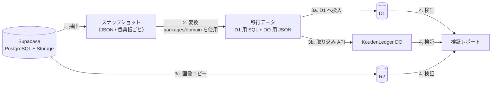

# 05. 移行計画

## 1. 実装マイルストーン

各マイルストーンの終わりにステージングへデプロイし、動作を確認する。

| # | マイルストーン | 内容 | 対応ストーリー |
|---|---|---|---|
| M0 | 基盤 | ドメイン取得、Cloudflare リソース作成、モノレポ・`cf`・CI、Tailwind・レイアウト、Google ログイン・セッション、公開サイトの骨格 | E1-1, E1-3, E11 |
| M1 | 台帳の骨格 | 香典帳の作成・一覧、`KoudenLedger` DO（マイグレーション機構・変更ログ）、行事・関係、いただきもの・差出人の CRUD、受付番号、受付画面、合計 | E2, E4-1〜6, E5-1, E5-3, E7-1 |
| M2 | 共同編集 | メンバー・招待リンク・ロール、WebSocket による同期・編集中表示・競合検出、変更履歴、オーナー譲渡、退出 | E3, E8 |
| M3 | 香典返し | カタログ（R2 画像）、金額帯ルール、一括提案、状況管理、リマインド（DO アラーム + Email Service） | E6 |
| M4 | 出力・課金 | 印刷用ページ、Excel（ライブラリ PoC を先に実施）、Stripe 購入・Webhook・無料版の上限 | E7-2, E7-3, E9 |
| M5 | 運営・仕上げ | 運営者 Worker（Access）、統計の投影・ダッシュボード、旧ユーザーの手動紐づけ、アカウント削除、アクセシビリティ確認、E2E | E1-4, E1-5, E10 |
| M6 | 移行 | 移行ツール、ステージングでのリハーサル（2 回以上）、本番の切り替え | E1-2 |

**進捗**: M0 完了（otomatty/kouden#161）。M1 完了（otomatty/kouden#162）。M2 完了（otomatty/kouden#163）。M3 完了（otomatty/kouden#164。カタログ・金額帯ルールは設定とは別の `/k/:id/returns/settings` に置いた）。M4 完了（otomatty/kouden#172。Excel のライブラリの PoC の結果は 04 §8。Stripe は SDK を使わず REST API を呼ぶ（04 §7））。M5 完了。2 回に分けた。1 回目（otomatty/kouden#173）: アカウント（表示名の変更・アカウントの削除）、運営者画面（`apps/admin`。Access の検証・ダッシュボード・検索・手動の有料化と購入の取り消し・旧ユーザーの手動紐づけ・監査ログ。DO には接続しない（04 §4））、共通のクラス名と色を `packages/ui` に切り出し。2 回目: アクセシビリティの確認（方針は 04 §6）と Playwright による E2E（`v2/e2e`。CI で実行する。04 §10）。M6 は 3 回に分ける。1 回目: 取り込み口（04 §4）と DO の `importSnapshot`、移行ツールの変換（`v2/tools/migrate-from-supabase`。§3 の対応表を `src/transform.ts` に実装し、自動で直せないデータは警告として残す）。2 回目: Supabase からの抽出・画像の R2 へのコピー（供物写真の表示を含む）・取り込みの実行・検証レポート・故人のお名前の確認の案内。3 回目: 書き戻しツール。残りの作業は otomatty/kouden#165 にまとめている。オフライン警告（E4-8）は WebSocket の接続状態と合わせて M2 で実装した。

切り替え後に「後続」のストーリー（E4-7 供物の写真の新規追加、E5-2 差出人の統合）を実装する。ただし、旧データの供物写真は M6 で移行する。

## 2. データ移行の全体像

ツールは `v2/tools/migrate-from-supabase/` に置き、Bun で実行する。各段階は**冪等**（何度実行しても同じ結果）にする。

| 段階 | 処理 |
|---|---|
| 1. 抽出 | Supabase の service key で全テーブルを読み、香典帳ごとの JSON にまとめる。Storage のオブジェクト一覧も取る |
| 2. 変換 | §3 の対応表に従って新しい形に変換する。ID は旧 UUID から決定的に生成（UUIDv5）し、再実行しても同じ ID になるようにする |
| 3a. D1 投入 | 移行専用の内部エンドポイント（04 §4「データ移行の取り込み口」。Access サービストークンで保護し、移行完了後に無効化）で `users` / `legacy_users` / `koudens` / `kouden_members` / `purchases` を投入。再実行で既存行を消さないよう `INSERT ... ON CONFLICT DO UPDATE` を使う（`INSERT OR REPLACE` は行を削除して入れ直すため、`ON DELETE CASCADE` で関連行まで消える）。当初は `cf d1 query` を使う予定だったが、DO と同じ認証・同じ検証（Zod）で書け、Workers ランタイム上のテストで SQL を確かめられるため、エンドポイントにした |
| 3b. DO 投入 | 同じ取り込み口（`PUT /internal/import/koudens/:koudenId`）が D1 の行を書いた後に `stub.importSnapshot(json)` を呼ぶ。DO は中身を全消去してから入れ直す |
| 3c. 画像 | Supabase Storage（`return-items`、供物写真）から R2 の `koudens/{koudenId}/…` へコピー |
| 4. 検証 | §5 の項目を香典帳ごとに比較し、1 件でも不一致があれば失敗にする |

## 3. 対応表（旧 → 新）

### ユーザー

| 旧 | 新 | 変換ルール |
|---|---|---|
| `auth.users` + `profiles` | D1 `users` | `legacy_user_id` = 旧 ID。`display_name` は `profiles.display_name`。アバターは移行しない（Google の画像を使う） |
| `auth.identities`（provider = google） | `users.google_sub` | `provider_id`（= Google の `sub`）をそのまま設定する。**Google ログインのユーザーは初回ログインで確実に紐づく** |
| `auth.identities`（provider = email） | `users.google_sub = NULL` + `legacy_users` | アドレスが Gmail / Google Workspace なら、初回の Google ログイン時にメールが一致すれば自動で紐づく（ADR-P17）。それ以外のアドレスは運営者が本人確認のうえ手動で紐づける |

### 香典帳とメンバー

| 旧 | 新 | 変換ルール |
|---|---|---|
| `koudens` | D1 `koudens` + DO `meta` | `deceased_name` は旧データにないので `title` から仮に設定し（「故 ○○ 様」なら ○○、それ以外は `title` のまま）、初回表示時にオーナーへ確認を促す。`plan` はすべて `paid`（ADR-P10）。`status` はそのまま（`active` / `archived` 以外は `active`） |
| `kouden_members` + `kouden_roles` | D1 `kouden_members.role` | `koudens.owner_id` の人 → `owner`（メンバーの行がなくても作る）。ロールの `permissions` に `edit`（または `entry.write` など書き込みの権限）を含む → `editor`。それ以外 → `viewer`。`added_by` → `invited_by`。存在しないユーザーのメンバーは移さない |
| `kouden_invitations` | 移行しない | 保留中の招待は切り替え後に再発行してもらう（告知文に記載） |
| `kouden_purchases` | D1 `purchases` | `source = 'legacy'`、`status = 'paid'`、`stripe_checkout_session_id` は旧値を保持 |

### 台帳（DO）

| 旧 | 新 | 変換ルール |
|---|---|---|
| — | `events` | 香典帳ごとに既定の行事「葬儀」を 1 件作成し、旧データはすべてここに入れる。受付番号は付けない（`receipt_no = NULL`） |
| `relationships` | `relationships` | そのまま |
| `kouden_entries` | `persons` + `gifts`（`kind = 'koden'`）+ `gift_contributors` | **1 件 = 1 人**として差出人を作る（自動での名寄せはしない。誤った統合を避けるため）。`name` と `organization` がどちらも NULL の行は、差出人の必須条件を満たさないため `name = '（氏名未記入）'` とし、`notes` に移行時の補完であることを記録する（件数は §4 の事前調査で確認する）。`attendance_type`: `FUNERAL` → `attended`、`CONDOLENCE_VISIT` → `condolence_visit`、`ABSENT` → `absent`。香典の `notes` は `gifts.notes` に移す |
| `offerings` | `gifts`（`kind` は `type` から写像: `FLOWER` → `kyoka`、`INCENSE` / `FOOD` → `kumotsu`、`MONEY` / `OTHER` → `other`） | `description` → `item_name`（空なら種類の名前）、`quantity`、`price`（→ `amount`）、`notes` を移す |
| `offering_allocations` / `offering_entries` | `gift_contributors` | 紐づく香典の差出人を供物の差出人にする。`allocated_amount` → `share_amount`、`is_primary_contributor` → `is_primary`（代表者がいなければ先頭、複数なら最初の 1 人）。紐づきがなければ `provider_name` で差出人を新規作成 |
| `offering_photos` | `gift_photos` + R2 | 画像を R2 にコピーし、キーを書き換える |
| `telegrams` | `gifts`（`kind = 'choden'`） | `message` → `message`。`kouden_entry_id` があればその差出人に、なければ `sender_*` から差出人を新規作成 |
| `return_items` | `return_items` | 画像を R2 にコピー。`recommended_amount_min/max` は `return_rules` の初期値にする（比率は 1/2） |
| `return_entry_records` | `returns` | 差出人単位に集約（同じ香典に複数の記録があれば、状況などは最後に更新した記録に従い、備考はつなげる）。`return_status`: `PENDING` → `pending`、`PARTIAL_RETURNED` → `arranged`、`COMPLETED` → `shipped`、`NOT_REQUIRED` → `not_required`。`return_method`（旧アプリでは自由入力。「郵送」「発送」など → `shipping`、「直接お渡し」「手渡し」など → `hand_delivery`、「当日」 → `on_day`。写像できなければ未選択にして備考に残す）、`funeral_gift_amount` → `on_day_amount`（当日返し）、送付先・手配日・備考を移す。発送日は旧データにないので、`shipped` なら最後に更新した日にする。記録がなく `kouden_entries.is_return_completed`（旧アプリの古い形式の「返礼済み」の印）だけがある香典は、発送済みの香典返しを作る（備考に移行時に作成したことを残す） |
| `return_record_items` + `return_entry_records.return_items`（JSON） | `return_lines` | 旧画面が表示・編集するのは JSON の列（一括更新などはこちらにだけ書き、表の行は古いまま残る）なので、記録ごとに JSON の列に品があればそれを正とする（返礼品の ID がカタログにあればその品に紐づける）。JSON の列に品がない記録だけ表の行から作る（品名・単価はカタログからのスナップショット）。JSON の列にない表の行は移さず、`stale_table_item` として検証レポートに載せる |
| `kouden_entry_audit_logs` | 移行しない | 変更ログには `op = 'import'` の 1 行だけを記録する |

### 移行しないもの

`admin_*`、`support_tickets` / `ticket_messages`、`system_announcements` / `announcements` / `user_announcement_reads`、`notifications`、`user_settings`、`user_surveys` / `user_survey_skips`、`campaign_hearing_applications`、`contact_requests`、`login_attempts`、`security_logs`、`debug_logs`、`kouden_entry_locks`。

これらは切り替え時に `pg_dump` で全体のバックアップを取り、アクセス制限付きの保管場所に 1 年間保存する。

> **事前確認**: 型定義には `common` / `gift` / `funeral` スキーマも存在する。アプリからは参照されていないが、本番にデータが入っていないかを抽出の前に確認する。

## 4. 移行前の準備

| 時期 | 作業 |
|---|---|
| M0 | 本番 Supabase の件数を調査する（ユーザー数、Google / メールの内訳、メールログインのうち Gmail / それ以外のアドレスの件数、香典帳数、最大の香典帳の件数、Storage の容量、`name` と `organization` がどちらも NULL の香典の件数）。移行時間の見積もりと変換規則の確認に使う |
| M6 開始時 | 本番のスナップショットでステージングへのリハーサルを行う。**リハーサル用のデータは個人情報を含むため、ステージング（Access で保護）でのみ扱い、リハーサル後に削除する** |
| 切り替え 14 日前 | 旧アプリにバナーとメールで告知する（停止日時、Google ログインへの一本化、メールログインの人への案内（Gmail 以外のアドレスだった人は切り替え後に問い合わせが必要なこと）、保留中の招待は再発行が必要なこと） |
| 切り替え 3 日前 | 最終リハーサル。所要時間を計測し、停止時間を確定する |

## 5. 検証項目

香典帳ごとに旧と新で比較し、すべて一致したら合格とする。

| 項目 | 旧 | 新 |
|---|---|---|
| 香典の件数・合計金額 | `kouden_entries` | `gifts`（`kind = 'koden'`） |
| 供物・弔電の件数 | `offerings` / `telegrams` | `gifts`（該当する `kind`） |
| 香典返しの件数・状況別件数 | `return_entry_records` | `returns` |
| 返礼品の件数 | `return_items` | `return_items` |
| メンバー数・オーナー | `kouden_members` / `koudens.owner_id` | D1 `kouden_members` |
| 画像の件数・サイズ | Storage のオブジェクト | R2 のオブジェクト |
| 全ユーザー | `auth.users` の件数 | `users` の件数 |

加えて、ランダムに抽出した 10 冊について、旧アプリと新アプリの画面を目視で比較する。

## 6. 切り替え手順（当日）

| 時刻 | 作業 | 失敗したら |
|---|---|---|
| T-0:00 | 旧アプリをメンテナンスモードにする（Vercel の環境変数でメンテナンス画面を表示し、書き込みを止める） | — |
| T+0:10 | 最終の抽出と `pg_dump` のバックアップ | 中止し、メンテナンスを解除 |
| T+0:30 | 変換 → D1 投入 → DO 投入 → 画像コピー | 本番の D1・DO・R2 を空にして再実行、または中止 |
| T+1:30 | 検証レポートの確認、目視確認 | 中止し、メンテナンスを解除（旧データは変更していないので戻せる） |
| T+2:00 | 内部の取り込みエンドポイントを無効化。新アプリを**運営者限定で**公開（Cloudflare Access で運営者のみ許可） | 新アプリを非公開に戻し、メンテナンスを解除 |
| T+2:30 | 運営者アカウントでログインを確認、テスト用香典帳で登録・同期・購入（テストモード）を確認。確認後、テスト用のデータを削除 | 新アプリを非公開に戻し、メンテナンスを解除 |
| T+2:45 | Access の制限を外して一般公開し、旧ドメインから新ドメインへ 301 リダイレクト | 下記「一般公開後の切り戻し」 |

**中止の判断基準**: 検証で 1 件でも不一致がある、または予定時間を 1 時間以上超過した場合は中止して旧アプリに戻す。一般公開（T+2:45）までは利用者の書き込みを受け付けず、旧アプリのデータもメンテナンス中に変更しないので、メンテナンスを解除するだけで元に戻る。

**一般公開後の切り戻し**: 一般公開後は、新環境にだけ存在する書き込みが発生する。原則として前進修正（新アプリの修正をデプロイ）で対応する。どうしても旧アプリに戻す場合は、新アプリを再びメンテナンス状態にして書き込みを止め、一般公開以降に新環境で作成・更新されたデータ（変更ログで特定できる）を Supabase の形式に書き戻し、§5 と同じ項目で検証してから旧アプリのメンテナンスを解除する。書き戻しツールは移行ツールの逆変換として M6 で用意しておく。

## 7. 切り替え後

| 時期 | 作業 |
|---|---|
| 当日〜7 日 | ログイン・紐づけ失敗の問い合わせに対応（運営者画面で手動紐づけ）。エラーログを毎日確認 |
| 30 日後 | 未ログインの旧ユーザー数を確認し、メールログインだった人へ個別に案内 |
| 90 日後 | Supabase プロジェクトを一時停止。Vercel プロジェクトを削除（旧ドメインのリダイレクトは継続） |
| 1 年後 | `pg_dump` のバックアップを削除。Supabase プロジェクトを削除 |
| 切り替え後すぐ | `legacy-nextjs` タグを打ち、旧実装のコードを `main` から削除。`AGENTS.md` を新構成に合わせて書き直す |
